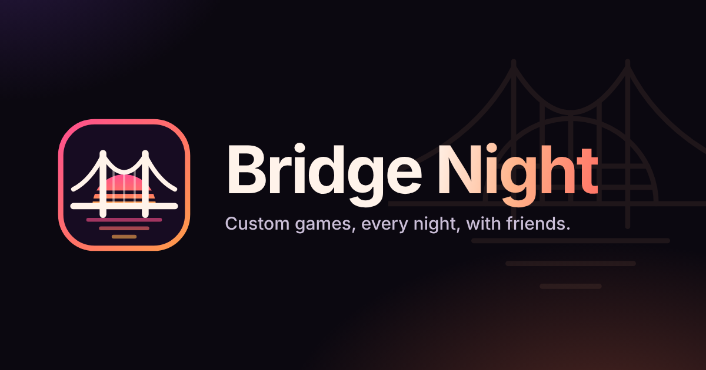
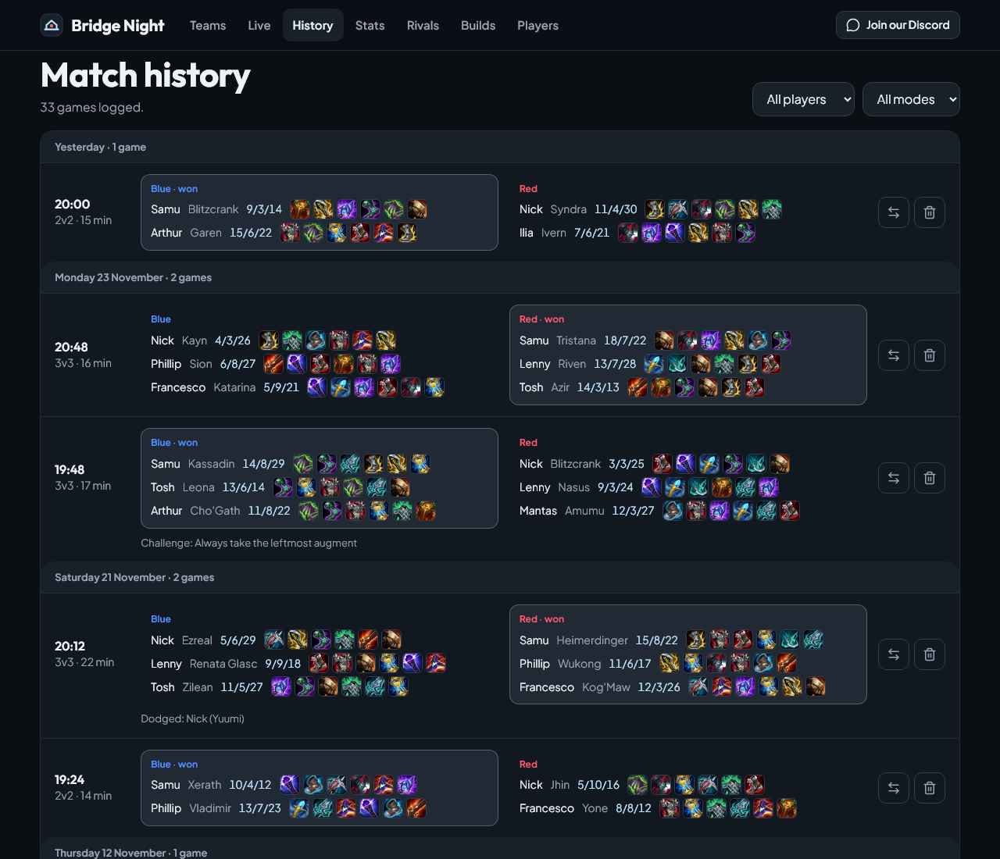
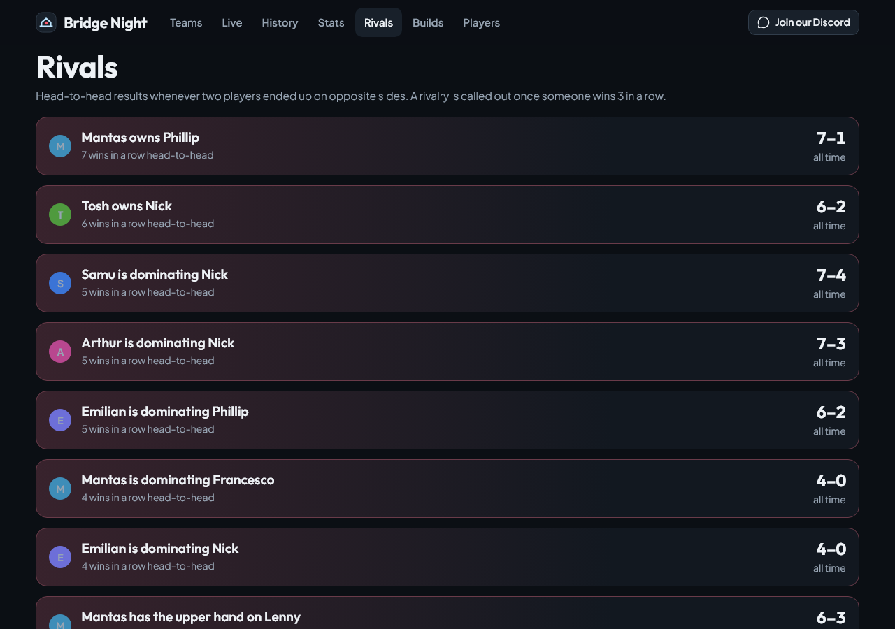

<div align="center">



### Who plays tonight?

Teams, live games, stats and rivalries for our League of Legends custom game nights.

<br/>

<a href="https://bridge-night.bridge-night.workers.dev"></a>&nbsp;
<a href="https://github.com/kasakuma99/bridge-night-/releases"></a>&nbsp;
<a href="https://discord.gg/mEAF2C9Qq"></a>

<sub>Private for our group · free to run · fan project</sub>

</div>

<br/>


<br/>

## How a night works

<table>
<tr>
<td width="33%" valign="top">

### `1` &nbsp;Make teams
Pick who's in, choose 1v1 to 5v5, and get fair teams. Reroll as often as you like.

</td>
<td width="33%" valign="top">

### `2` &nbsp;Play
The helper on one player's PC follows the custom game and shows it live on the site.

</td>
<td width="33%" valign="top">

### `3` &nbsp;See who's on fire
The result saves itself. Elo, streaks, rivals and awards update right away.

</td>
</tr>
</table>

## On the site

<p align="center"></p>

<table>
  <tr>
    <td width="50%"><p align="center"><b>Stats</b> · Elo, streaks, awards</p></td>
    <td width="50%"><p align="center"><b>History</b> · every game, every item</p></td>
  </tr>
  <tr>
    <td width="50%"><p align="center"><b>Rivals</b> · head-to-head records</p></td>
    <td width="50%"><p align="center"><b>Builds</b> · open a build in one click</p></td>
  </tr>
</table>

<sub>Sample data from an earlier version. Some pages are switched off for now in <a href="src/lib/features.ts">features.ts</a>.</sub>

## The helper app &nbsp;<sup><kbd>v0.6.0</kbd></sup>

A tiny Windows tray app. **One player per game** runs it, and nobody has to type in results.

> **Reads, never controls.** It only reads the League client on your own PC, never clicks or picks anything, and only cares about custom games. Champions show up on the loading screen, when everyone can see them anyway.

| | |
|---|---|
| **New window** | Status, setup, settings and log, plus live CPU and GPU gauges |
| **Safe** | No admin rights, no service, no ads, no tracking. Open source |
| **Your token** | Talks only to our site, with a token you make on the Helper page |

**Set up:** log in with Discord → get approved → **Helper** tab → download → **Make a token** → paste it into the helper → **Save and test**.

<details>
<summary><b>How do I know the download is safe?</b></summary>
<br/>

The release notes and the Helper page show the file's SHA-256 fingerprint. In PowerShell, run `Get-FileHash .\bridge-night-helper.exe` and compare. The app isn't code-signed, so Windows may say "unknown publisher" (More info → Run anyway). All of its code is in [`helper/`](helper).

</details>

<br/>


<p align="center">
<b>Mini window</b> &nbsp;·&nbsp; <b>Performance charts</b> &nbsp;·&nbsp; <b>Instant replay</b> &nbsp;·&nbsp; <b>Mic mute everywhere</b> &nbsp;·&nbsp; <b>Ping check</b><br/>
<sub>A design concept for the next helper. Not built yet, and it stays light: nothing runs in the background that you didn't switch on.</sub>
</p>

## What's new

- **Helper 0.6.0:** new window with a sidebar and CPU/GPU gauges
- **Helper 0.5.0:** live games go through our own live server
- **Private site:** Discord login, admin approval, data closed to strangers
- **Live page:** levels, K/D/A, items, spells and augments for everyone
- **Elo ranking:** a rating per player, with placement games
- **Teams page:** redesigned, with Shuffle, Choose or Fair sit-outs

<details>
<summary>More changes</summary>
<br/>

- Login popup, account menu, offline and new-version notices, a better 404 page
- Stricter security: Content Security Policy, safer helper links, a security review
- Fair play: no champions during champ select
- Members make their own helper tokens; they stop working when a member is removed

</details>

<br/>

<a href="https://discord.gg/mEAF2C9Qq"></a>

<br/>

<details>
<summary><b>How it runs for free</b></summary>
<br/>

| Part | Runs on |
|---|---|
| Website | Cloudflare Workers, deployed automatically from `main` |
| Database, login, live updates | Supabase (Postgres, Discord login, Realtime) |
| Live games | Supabase Edge Function `live` |
| Backups and keep-alive | A Cloudflare Worker on a timer: daily keep-alive, weekly backup (last 8 kept) |
| Helper builds | GitHub Actions |

</details>

<details>
<summary><b>Security and privacy</b></summary>
<br/>

- The site is private. Row Level Security on every table: without approval you can read nothing.
- Riot IDs of people who aren't on the site are never stored, and live data has no Riot IDs at all.
- Helper tokens are stored only as a SHA-256 hash and can be revoked at any time.
- Only the public Supabase key is in this repository. Secret keys live only in Supabase and Cloudflare.

</details>

<details>
<summary><b>Run it locally</b></summary>
<br/>

```bash
npm install
npm run dev:sample   # sample players and games, no account needed
npm run dev:live     # sample data plus the game League is playing on this PC
npm run dev:db       # the real database, with login: changes are real!
npm test             # unit tests, database changes and the live server
npm run e2e          # clicks through the site (first: npm run dev:sample -- --port 5174)
npm run typecheck
.\helper\build.ps1   # builds the helper with the C# compiler that ships with Windows
```

- `src/lib/` holds the rules as plain functions: Elo, streaks, badges, awards, rivalries, team generator. Times use Europe/Berlin.
- `src/data/` is the only place that changes data, with a local store for samples and a Supabase store for the live site.
- `supabase/` has the database schema, security rules and the live function. [docs/release.md](docs/release.md) has the release steps.
- New work happens on `<topic>-dev` branches first; `main` is the live site.

</details>

<br/>

<div align="center">

**Built with** &nbsp; React · TypeScript · Tailwind · Supabase · Cloudflare · C#

Thanks to **Lenny** and **Tosh** for their help, and to everyone who shows up on game night.

<sub>Bridge Night is a fan project, made by friends for friends.<br/>
Bridge Night was created under Riot Games' "Legal Jibber Jabber" policy using assets owned by Riot Games. Riot Games does not endorse or sponsor this project.</sub>

</div>
