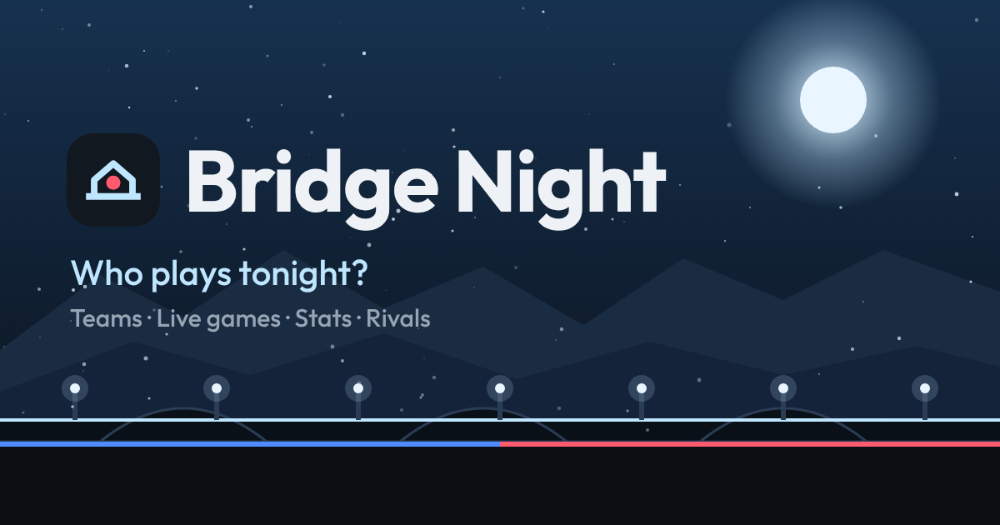
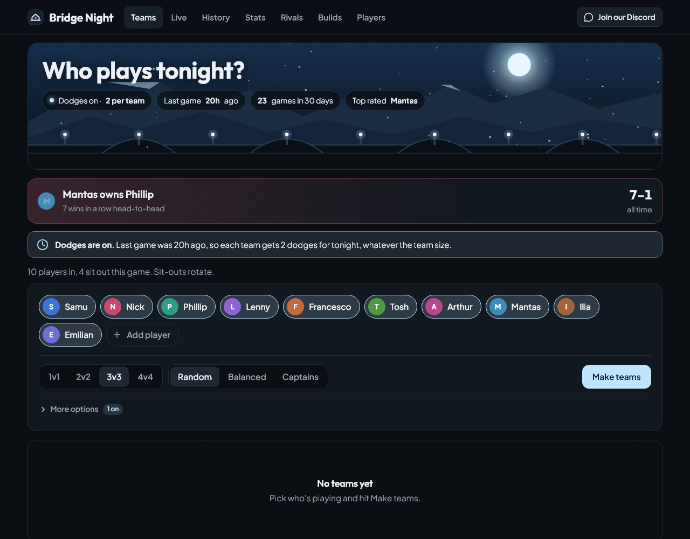
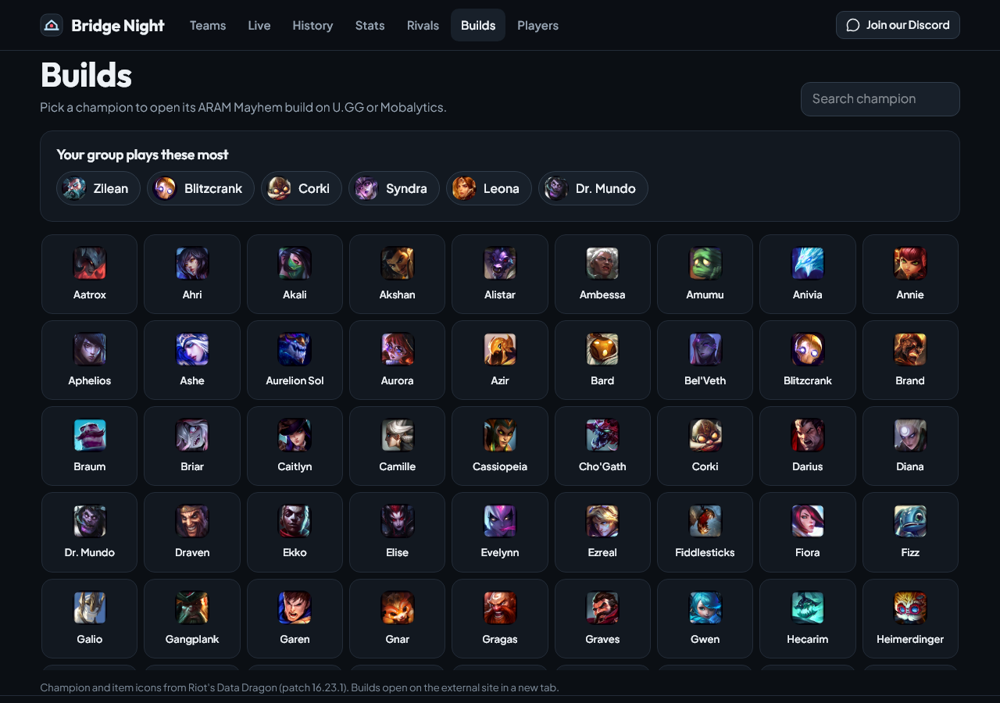
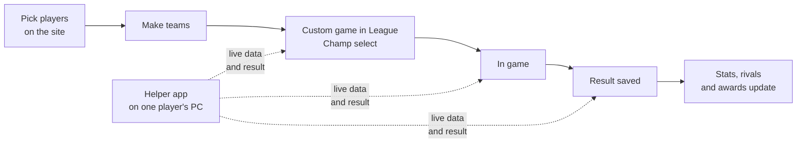

<div align="center">



# Bridge Night

**Who plays tonight?** Team generator, live games, past games, stats and rivalries for our custom game nights.

[](https://bridge-night.bridge-night.workers.dev)
[](https://github.com/kasakuma99/bridge-night-/releases)
[](#how-it-runs-for-free)

**[Open the site](https://bridge-night.bridge-night.workers.dev)** · **[Get the helper app](https://github.com/kasakuma99/bridge-night-/releases)** · **[Join our Discord](https://discord.gg/mEAF2C9Qq)**

</div>

---

## What it does

Bridge Night is the home of our ARAM Mayhem custom games: 1v1 up to 5v5, a few nights a week, always with the same group of friends. The site is private: you log in with Discord, and an admin lets you in. It started as a clickable prototype and grew into a small app we actually use on game night.

|  |  |
|---|---|
| **Team generator** | Pick a mode from 1v1 to 5v5 and who's playing. Random or weighted teams, uneven teams if you like, fair sit-out rotation, unlimited rerolls. |
| **Live game** | Follows the custom game in League by itself: both sides, champions, levels, K/D/A, items, summoner spells, clock and log. After the game who won, why, and the augments. |
| **Past games** | Every game with teams and champions, and a details table with level, K/D/A, items and augments. |
| **Stats** | Leaderboard, streaks, records, best duos and trios, weekly awards, monthly champions and player profiles with badges. |
| **Rivals** | Head-to-head records and "Samu is dominating Nick" banners when someone keeps winning. |
| **Helper app** | Small Windows tray app for one player per game. It reads League and shows the game on the site. |
| **Phone friendly** | Add it to your home screen and it opens like an app. |

## Screenshots

<p align="center"></p>

<table>
  <tr>
    <td></td>
    <td></td>
  </tr>
  <tr>
    <td></td>
    <td></td>
  </tr>
</table>

<sub>Screenshots use sample data and show an earlier version: some of it is switched off in [features.ts](src/lib/features.ts).</sub>

## How a game night works



Only approved members see the site: you log in with Discord, then an admin lets you in and links you to your player. One player per game runs the helper app; if several do, the game is still saved once. If League names no winner, a member chooses. Only admins can swap a winner or delete a game.

## The helper app

A tiny Windows tray app (about 50 KB), built from [`helper/BridgeNightHelper.cs`](helper/BridgeNightHelper.cs) by GitHub Actions and published under [Releases](https://github.com/kasakuma99/bridge-night-/releases).

- **Read-only.** It only reads what the League client and the game offer to programs on your own PC (the Live Client Data API), and never sends commands to them.
- **Fair play.** During champ select it sends only names and sides. Champions follow on the loading screen, when everyone sees them.
- **Custom games only.** From other games nothing is read or sent.
- **One server.** It only talks to our site, with your personal helper token.
- **No admin rights, no service, no autostart** unless you tick it. No ads, no tracking.

**Set it up:** log in on the site with Discord → get approved → Helper tab → download → **Make a token** → paste it into the helper → **Save and test connection**.

**Check it's safe:** the release notes and the Helper page show the file's SHA-256. In PowerShell, `Get-FileHash .\bridge-night-helper.exe` must show the same value. The app isn't code-signed, so Windows may say "unknown publisher" (More info → Run anyway).

## How it runs for free

| Part | Runs on |
|---|---|
| Website | Cloudflare Workers (static assets), deployed automatically from `main` |
| Database, login, live updates | Supabase (Postgres, Discord login, Realtime) |
| Live games | Supabase Edge Function `live` (and `helper` for helpers before 0.5) |
| Backups and keep-alive | A Cloudflare Worker on a timer: daily keep-alive, weekly JSON backup to Workers KV (last 8 kept) |
| Helper builds | GitHub Actions |

### Security

- The site is private. Row Level Security on every table: without approval you can read nothing.
- Riot IDs of people who aren't on the site are never stored or shown, and the live data has no Riot IDs at all.
- Helper tokens are stored only as a SHA-256 hash and can be revoked at any time.
- Only the public Supabase key is in this repo (it's designed for browsers). Secret keys live only in Supabase and Cloudflare.
- Strict Content Security Policy on the site.

## Built with

Vite · React · TypeScript · Tailwind CSS · Supabase · Cloudflare Workers · lucide icons · Outfit and Plus Jakarta Sans · C# (.NET Framework, ships with Windows) for the helper.

<details>
<summary><b>Run it locally</b></summary>

```bash
npm install
npm run dev:sample   # http://localhost:5173 with sample players and games, no account needed
npm run dev:live     # sample data plus the game League is playing on this PC, nothing leaves it
npm run dev:db       # the real database, with login: changes are real!
npm test             # unit tests, also the database changes in a small Postgres and the live server
npm run e2e          # clicks through the site (first: npm run dev:sample -- --port 5174)
node scripts/build-live.mjs   # after changing src/lib/live*.ts: bundles it for the live function
npm run typecheck
.\helper\build.ps1   # builds the helper with the C# compiler that ships with Windows (-Test: a separate test program)
```

- `src/lib/` holds the rules as plain functions: per-player Elo (start 1000; after 10 placement games a 100 point gap gives the favourite 13 and the underdog 17; FF costs 5 extra; small streak and bounty bonuses), streaks, bounties, badges, awards, monthly champions, rivalries, team generator and the dodge rule. Times use Europe/Berlin.
- `src/data/` is the only place that changes data: a local store for the sample preview and a Supabase store for the live site, behind the same interface. Ratings and awards are always recalculated from the full match list.
- `supabase/migrations/` has the database schema, security rules and functions. `supabase/functions/live/` takes the live games: the logic is `src/lib/live.ts` and `liveServer.ts`, bundled into `core.js`. [docs/release.md](docs/release.md) has the release steps.
- `backup-worker/` is the backup and keep-alive worker.

</details>

## Thanks

Big thanks to **Lenny** and **Tosh** for their help with Bridge Night. 💙

And to everyone who shows up on game night.

---

<sub>Bridge Night is a fan project, made by friends for friends.<br/>
Bridge Night was created under Riot Games' "Legal Jibber Jabber" policy using assets owned by Riot Games. Riot Games does not endorse or sponsor this project.</sub>
