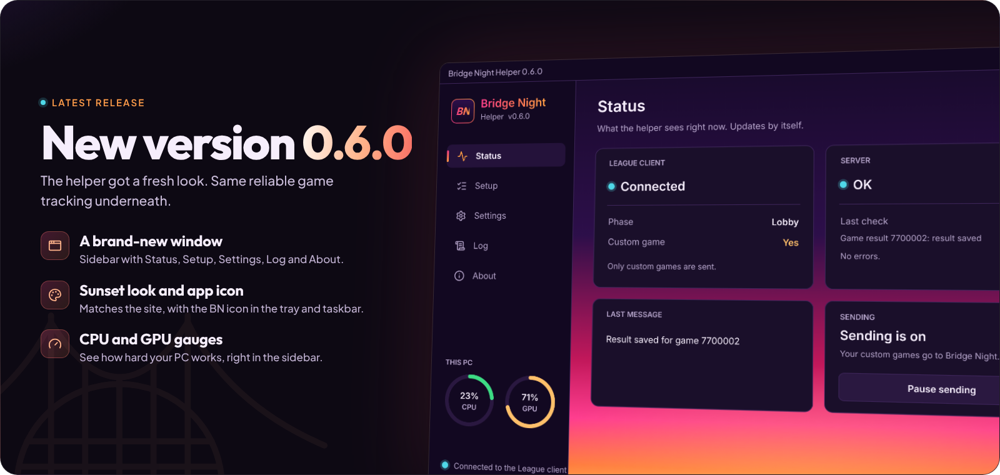
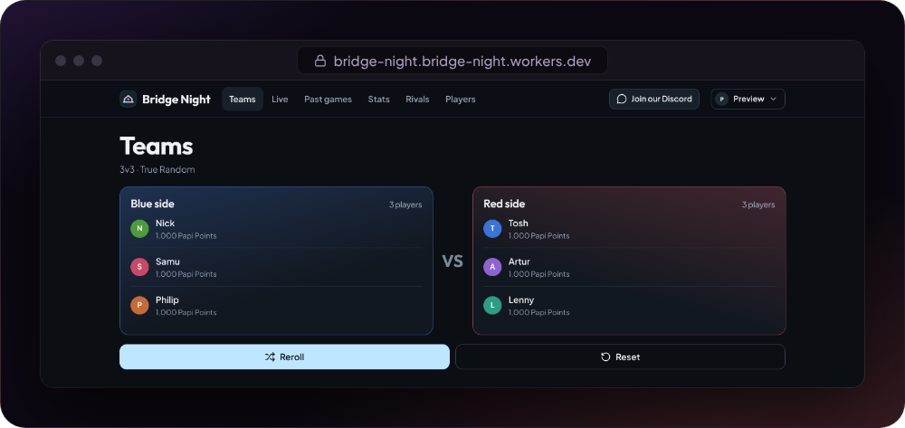
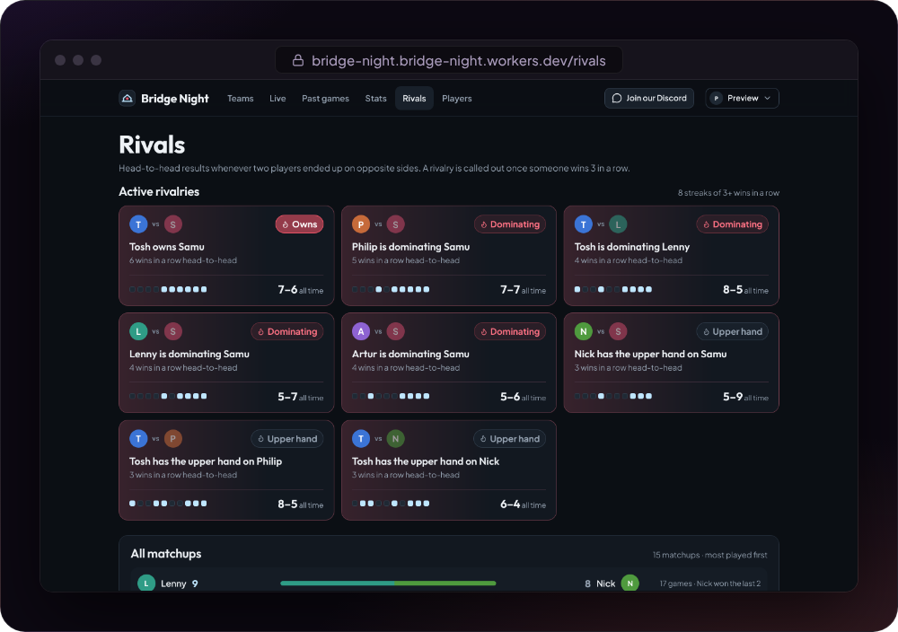

<h3>Who plays tonight?</h3>

Teams, live games, stats and rivalries for our League of Legends custom game nights.

 

&nbsp;
&nbsp;

<a href="https://bridge-night.bridge-night.workers.dev"><b>bridge-night.bridge-night.workers.dev</b></a>

Private for our group · free to run · fan project

  

  

<a href="https://github.com/kasakuma99/bridge-night-/releases"><b>Download helper 0.6.0 →</b></a>

 

  

<h2>On the site</h2>

<b>Live game</b> · champions, levels, K/D/A, items and a log while you play

<table>
  <tr>
    <td width="50%" align="center"> <b>Teams</b> · fair teams in one click</td>
    <td width="50%" align="center"> <b>Stats</b> · leaderboard, streaks and profiles</td>
  </tr>
  <tr>
    <td width="50%" align="center"> <b>Past games</b> · every game, every item</td>
    <td width="50%" align="center"> <b>Rivals</b> · who's dominating whom</td>
  </tr>
</table>

Screenshots with sample data.

  

<h2>The helper app</h2>

A tiny Windows tray app. <b>One player per game</b> runs it, and the game shows up on the site by itself.

<b>Reads, never controls</b> &nbsp;·&nbsp; <b>Custom games only</b> &nbsp;·&nbsp; <b>No admin rights</b> &nbsp;·&nbsp; <b>Open source</b>

Set up: log in with Discord → get approved → Helper tab → download → make a token → paste it into the helper.

 

A design concept for the next helper. Not built yet.

 

  

<b>Bridge Night</b> Made by friends for friends. Thanks to <b>Lenny</b> and <b>Tosh</b>, and to everyone who shows up on game night.

<a href="docs/DEVELOPMENT.md">How it's built and how to run it</a> &nbsp;·&nbsp; <a href="https://github.com/kasakuma99/bridge-night-/releases">Releases</a> &nbsp;·&nbsp; <a href="https://discord.gg/mEAF2C9Qq">Discord</a>

Bridge Night was created under Riot Games' "Legal Jibber Jabber" policy using assets owned by Riot Games. Riot Games does not endorse or sponsor this project.

