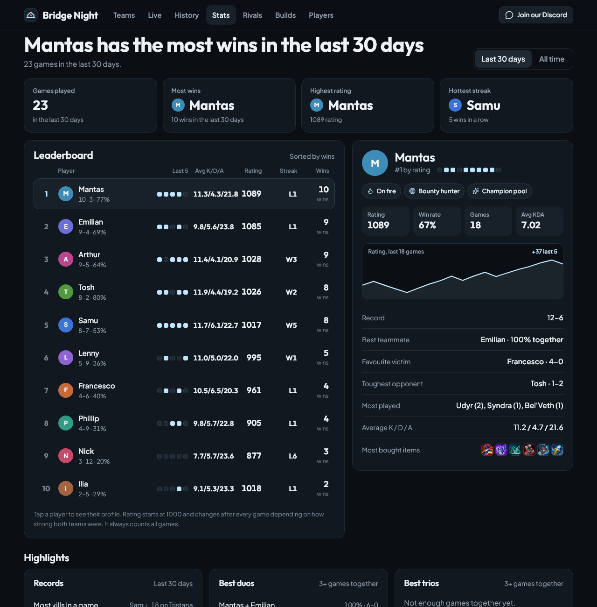
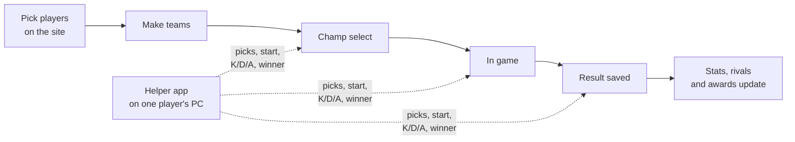

<div align="center">


# Bridge Night

**Who plays tonight?** Team generator, live games, match history, stats and rivalries for our custom game nights.

[](https://bridge-night.bridge-night.workers.dev)
[](https://github.com/kasakuma99/bridge-night-/releases)
[](#how-it-runs-for-free)

**[Open the site](https://bridge-night.bridge-night.workers.dev)** · **[Get the helper app](https://github.com/kasakuma99/bridge-night-/releases)** · **[Join our Discord](https://discord.gg/mEAF2C9Qq)**

</div>

---

## What it does

Bridge Night is the home of our ARAM Mayhem custom games: 1v1 up to 4v4, a few nights a week, always with the same group of friends. It started as a clickable prototype and grew into a small app we actually use on game night.

|  |  |
|---|---|
| **Team generator** | Tap who's playing. Random, Balanced (by rating) or Captains with snake draft. Fair sit-out rotation, reroll limit, "keep these two apart", bounties on win streaks. |
| **Live game** | Champ select, in game, result. Shared live with everyone who has the site open. Our dodge rule is built in. |
| **Match history** | Every game with teams, champions, K/D/A, items, dodges and the random challenge, if there was one. |
| **Stats** | Elo-style ratings, streaks, records, best duos and trios, weekly awards, monthly champions and player profiles with badges. |
| **Rivals** | Head-to-head records and "Samu is dominating Nick" banners when someone keeps winning. |
| **Builds** | Champion search with links to ARAM Mayhem builds on U.GG and Mobalytics. |
| **Helper app** | Optional Windows tray app. Fills in picks, K/D/A, items and the winner by itself, so nobody has to type. |
| **Phone friendly** | Add it to your home screen and it opens like an app. |

## Screenshots

<p align="center"></p>

<table>
  <tr>
    <td></td>
    <td></td>
  </tr>
  <tr>
    <td></td>
    <td></td>
  </tr>
</table>

<sub>Screenshots use sample data from the local preview.</sub>

## How a game night works



Anyone with the link can watch. Friends who log in with Discord and get approved can make teams and save results. Only one player per game needs the helper app; if several run it, the game is still saved once.

## The helper app

A tiny Windows tray app (about 30 KB), built from [`helper/BridgeNightHelper.cs`](helper/BridgeNightHelper.cs) by GitHub Actions and published under [Releases](https://github.com/kasakuma99/bridge-night-/releases).

- **Read-only.** It only reads the League client's local data on your own PC and never sends commands to it.
- **Custom games only.** It ignores your normal games.
- **One server.** It only talks to our site, with your personal helper token.
- **No admin rights, no service, no autostart** unless you tick it. No ads, no tracking.

**Set it up:** log in on the site with Discord → get approved → Helper tab → download → **Make a token** → paste it into the helper → **Save and test connection**.

**Check it's safe:** the release notes and the Helper page show the file's SHA-256. In PowerShell, `Get-FileHash .\bridge-night-helper.exe` must show the same value. The app isn't code-signed, so Windows may say "unknown publisher" (More info → Run anyway).

## How it runs for free

| Part | Runs on |
|---|---|
| Website | Cloudflare Workers (static assets), deployed automatically from `main` |
| Database, login, live updates | Supabase (Postgres, Discord login, Realtime) |
| Helper endpoint | Supabase Edge Function |
| Backups and keep-alive | A Cloudflare Worker on a timer: daily keep-alive, weekly JSON backup to Workers KV (last 8 kept) |
| Helper builds | GitHub Actions |

### Security

- Row Level Security on every table. Visitors can only read public game data.
- Riot IDs, members and helper tokens are never visible to visitors.
- Helper tokens are stored only as a SHA-256 hash and can be revoked at any time.
- Only the public Supabase key is in this repo (it's designed for browsers). Secret keys live only in Supabase and Cloudflare.
- Strict Content Security Policy on the site.

## Built with

Vite · React · TypeScript · Tailwind CSS · Supabase · Cloudflare Workers · lucide icons · Outfit and Plus Jakarta Sans · C# (.NET Framework, ships with Windows) for the helper.

<details>
<summary><b>Run it locally</b></summary>

```bash
npm install
npm run dev:sample   # http://localhost:5173 with sample players and games, no account needed
npm run dev          # uses the real database (needs .env.local with the Supabase URL and public key)
npm test             # unit tests: ratings, stats, team generator, dodge rule, links, data store
npm run typecheck
.\helper\build.ps1   # builds the helper with the C# compiler that ships with Windows
```

- `src/lib/` holds the rules as plain functions: ratings (start 1000, K=32, team average vs team average), streaks, bounties, badges, awards, monthly champions, rivalries, team generator and the dodge rule. Times use Europe/Berlin.
- `src/data/` is the only place that changes data: a local store for the sample preview and a Supabase store for the live site, behind the same interface. Ratings and awards are always recalculated from the full match list.
- `supabase/migrations/` has the database schema, security rules and functions. `supabase/functions/helper/` is the helper endpoint.
- `backup-worker/` is the backup and keep-alive worker.

</details>

## Thanks

Big thanks to **Lenny** and **Tosh** for their help with Bridge Night. 💙

And to everyone who shows up on game night.

---

<sub>Bridge Night is a fan project, made by friends for friends.<br/>
Bridge Night was created under Riot Games' "Legal Jibber Jabber" policy using assets owned by Riot Games. Riot Games does not endorse or sponsor this project.</sub>
