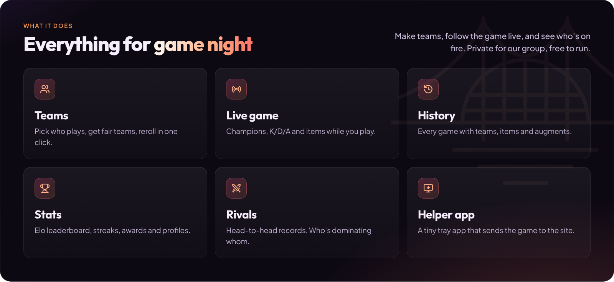
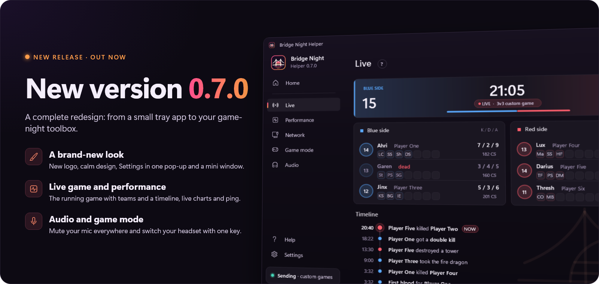
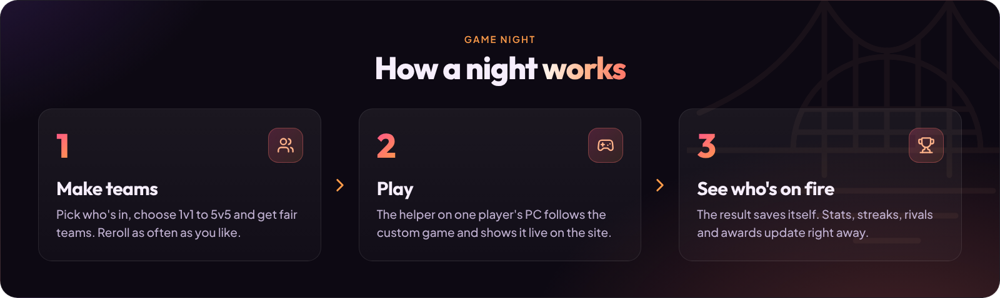
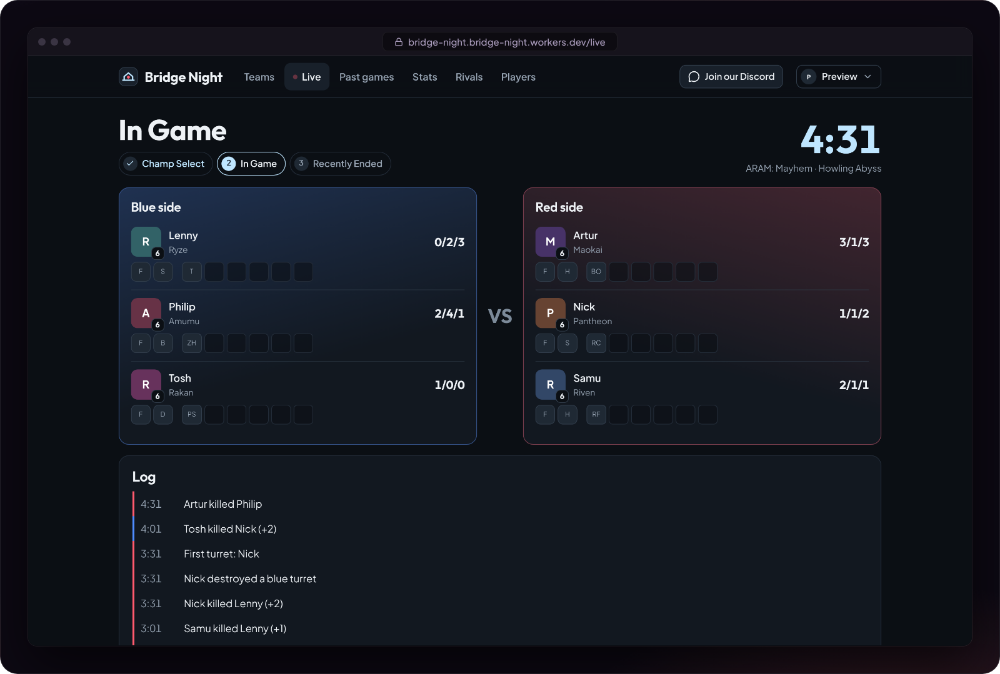
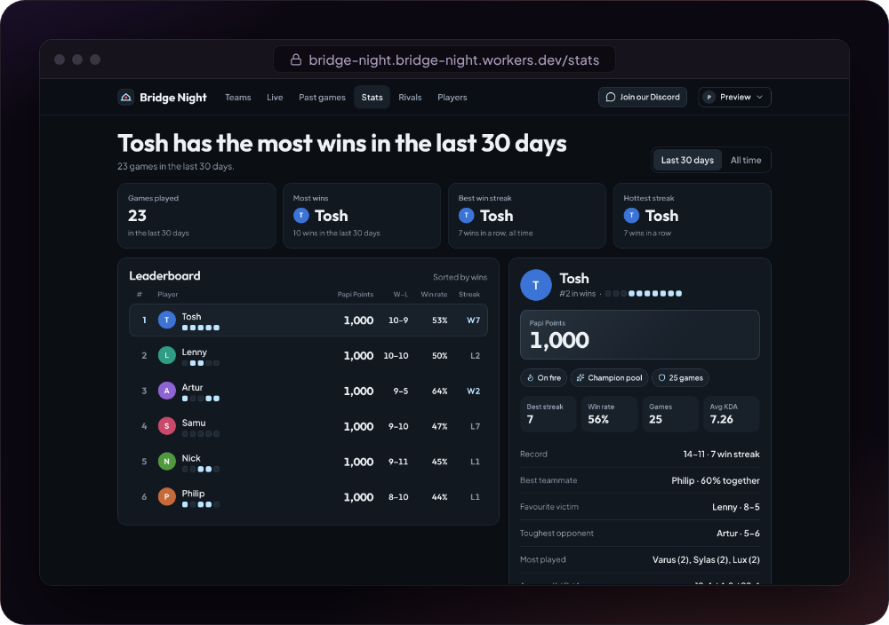
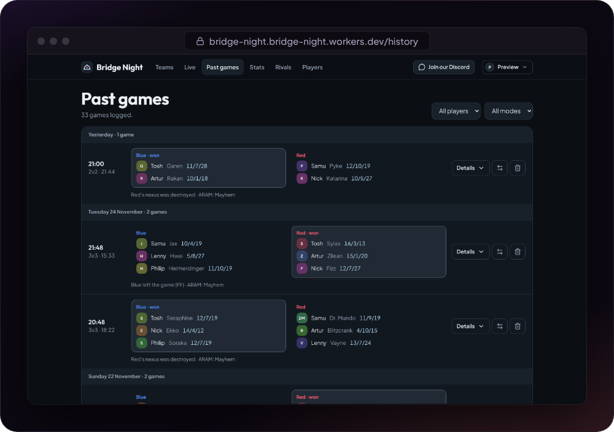
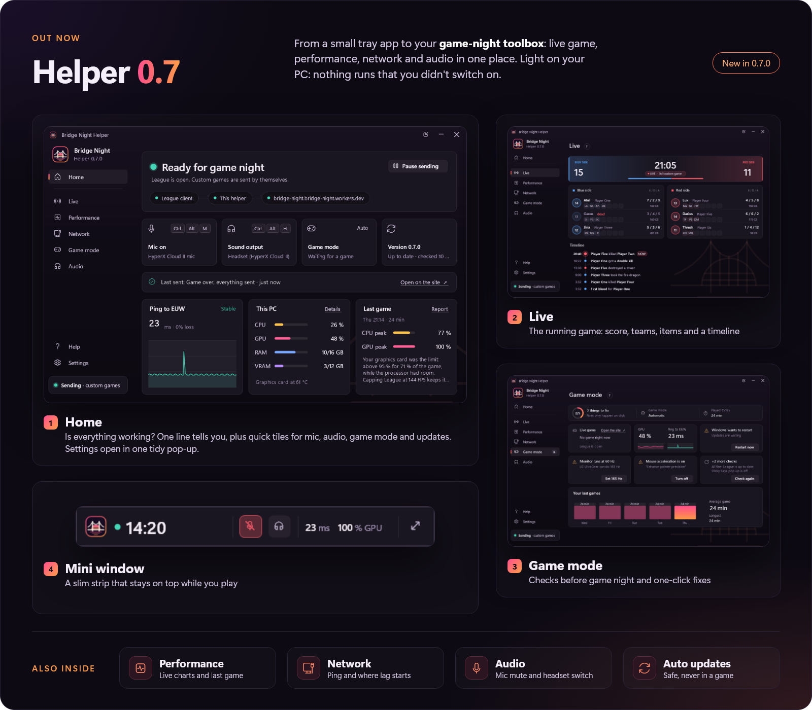
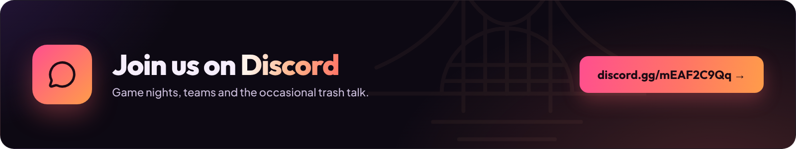
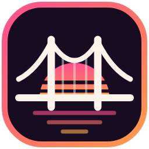

<h3>Who plays tonight?</h3>

Teams, live games, stats and rivalries for our League of Legends custom game nights.

 

&nbsp;
&nbsp;

<a href="https://bridge-night.bridge-night.workers.dev"><b>bridge-night.bridge-night.workers.dev</b></a>

Private for our group · free to run · fan project

  

Bridge Night is the home of our ARAM Mayhem custom games. It turns a group chat full of 
"who's in?" into a proper game night: fair teams in seconds, the game followed live, 
and every result saved, so the stats, streaks and rivalries build up over time.

It has two parts: a <b>private website</b> for the whole group, and a small <b>Windows helper app</b> 
that one player runs during the game, so nobody ever has to type in a result.

 

  

<b>Coming soon.</b> Until then, <a href="https://github.com/kasakuma99/bridge-night-/releases">helper 0.6.0</a> is the current download.

 

  

<h2>On the site</h2>

<b>Live game</b> · champions, levels, K/D/A, items and a log while you play

<table>
  <tr>
    <td width="50%" align="center"> <b>Teams</b> · fair teams in one click</td>
    <td width="50%" align="center"> <b>Stats</b> · leaderboard, streaks and profiles</td>
  </tr>
  <tr>
    <td width="50%" align="center"> <b>Past games</b> · every game, every item</td>
    <td width="50%" align="center"> <b>Rivals</b> · who's dominating whom</td>
  </tr>
</table>

Screenshots with sample data.

  

<h2>The helper app</h2>

A small Windows tray app that connects League of Legends to the site. 
<b>One player per game</b> runs it, and picks, K/D/A, items and the result appear on the site by themselves.

<table>
  <tr><td align="center"><b>Reads, never controls</b> It only reads the League client on your own PC. It never clicks, picks or changes anything.</td>
      <td align="center"><b>Custom games only</b> Normal and ranked games are ignored. Champions appear from the loading screen on.</td></tr>
  <tr><td align="center"><b>Safe by design</b> No admin rights, no background service, no ads, no tracking. All code is public.</td>
      <td align="center"><b>Your own token</b> It talks only to our site, with a personal token you can revoke at any time.</td></tr>
</table>

Set up: log in with Discord → get approved → Helper tab → download → make a token → paste it into the helper.

 

<h3>What's coming in 0.7.0</h3>

Version 0.7.0 turns the helper into a complete game-night toolbox, 
built to stay light: nothing runs in the background that you didn't switch on.

<table>
  <tr><th>Feature</th><th>What it does</th></tr>
  <tr><td><b>Home</b></td><td>One clear status line (League, helper, site), check in for tonight's game night, and quick tiles for mic, audio, game mode and Discord status.</td></tr>
  <tr><td><b>Performance</b></td><td>Live charts for CPU, GPU, memory and video memory, a report of how your PC handled the last game, and which apps use the most. Measures every 1, 5 or 10 seconds, or not at all.</td></tr>
  <tr><td><b>Instant replay</b></td><td>Saves the last 15, 30 or 60 seconds with one hotkey, named after your champion and score, and small enough to share in Discord. Off by default.</td></tr>
  <tr><td><b>Network</b></td><td>Ping, jitter and packet loss to the EUW server, and whether lag comes from your Wi-Fi, your provider or Riot.</td></tr>
  <tr><td><b>Game mode</b></td><td>A check before game night (pending Windows restart, League patch), a high-performance power plan during games, and one-click fixes for common settings like a monitor stuck at 60 Hz.</td></tr>
  <tr><td><b>Audio</b></td><td>Mute your microphone everywhere at once, in Discord, League and the browser, and switch between headset, speakers and monitor with one key.</td></tr>
  <tr><td><b>Mini window</b></td><td>A slim strip that stays on top while you play: status, mic, ping, GPU load and the game timer.</td></tr>
  <tr><td><b>Notifications</b></td><td>A short heads-up when teams are locked, when a result is saved with your rating change, and before game night, each with a button to the site.</td></tr>
  <tr><td><b>Help and tour</b></td><td>A short tour on first start that you can skip, and a Help page that explains every part.</td></tr>
</table>

Teams, history, stats and rivals stay on the site. The helper only does what needs your PC.

 

  

<b>Bridge Night</b> Made by friends for friends. Thanks to <b>Lenny</b> and <b>Tosh</b>, and to everyone who shows up on game night.

<a href="docs/DEVELOPMENT.md">How it's built and how to run it</a> &nbsp;·&nbsp; <a href="https://github.com/kasakuma99/bridge-night-/releases">Releases</a> &nbsp;·&nbsp; <a href="https://discord.gg/mEAF2C9Qq">Discord</a>

Bridge Night was created under Riot Games' "Legal Jibber Jabber" policy using assets owned by Riot Games. Riot Games does not endorse or sponsor this project.

