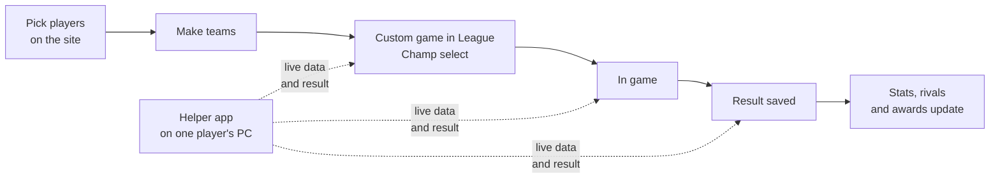
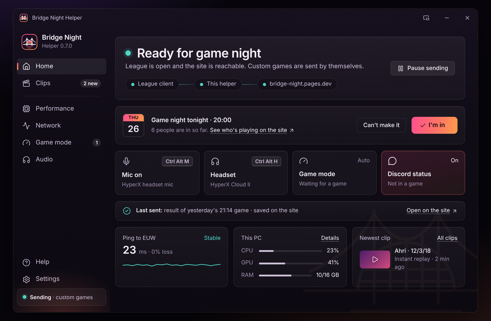
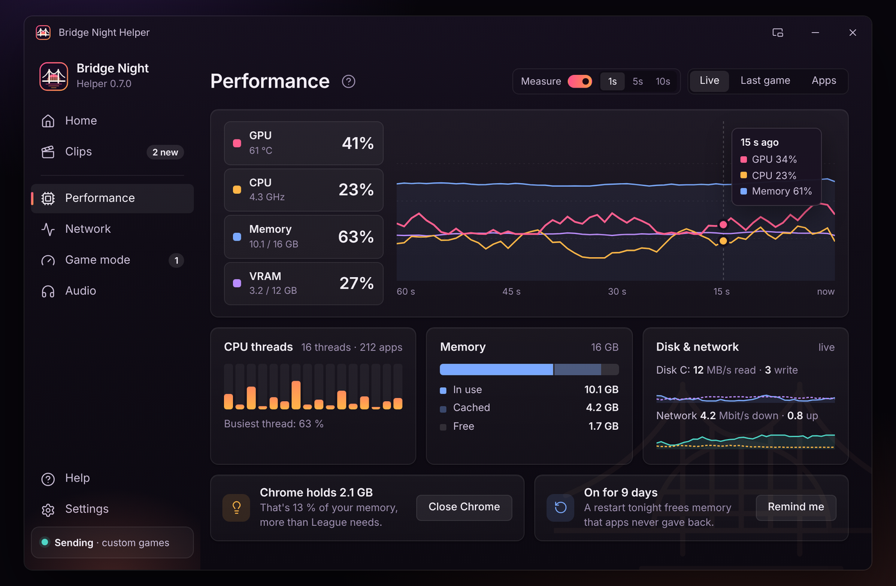
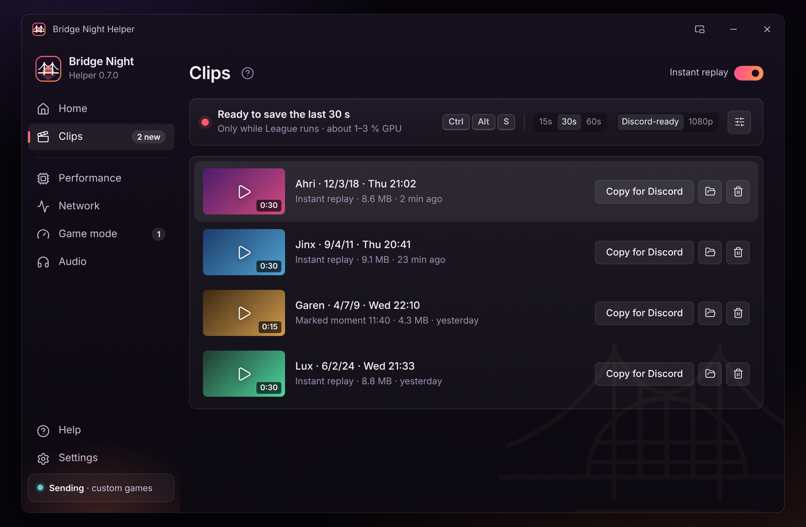
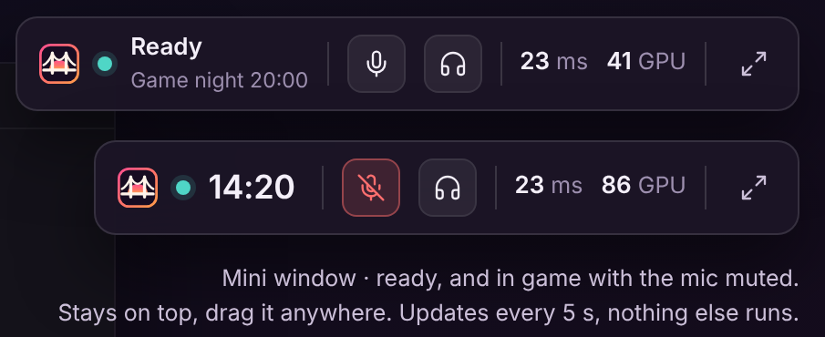

<div align="center">


**Who plays tonight?** Team generator, live games, match history, stats and rivalries for our League of Legends custom game nights.

[](https://bridge-night.bridge-night.workers.dev)
[](https://github.com/kasakuma99/bridge-night-/releases)
[](#how-it-runs-for-free)

**[Open the site](https://bridge-night.bridge-night.workers.dev)** · **[Get the helper app](https://github.com/kasakuma99/bridge-night-/releases)** · **[Join our Discord](https://discord.gg/mEAF2C9Qq)**

</div>

---

## About

Bridge Night is the home of our ARAM Mayhem custom games: 1v1 up to 5v5, a few nights a week, always with the same group of friends. It started as a clickable prototype and grew into a small app we actually use on game night.

It has two parts:

- **The website** is where the group meets: make teams, follow the game live, look back at past games, stats and rivalries. It is private: you log in with Discord and an admin lets you in.
- **The helper app** is a small Windows tray app. One player per game runs it. It reads the custom game on that PC and sends it to the site, so nobody has to type in results.

## What the site does

|  |  |
|---|---|
| **Team generator** | Pick a mode from 1v1 to 5v5 and who's playing. Random or weighted teams, uneven teams if you like, a fair sit-out rotation, unlimited rerolls. |
| **Live game** | Follows the custom game by itself: both sides, champions, levels, K/D/A, items, summoner spells, clock and a log. After the game: who won, how, and the augments. |
| **Match history** | Every game with teams and champions, plus a details table with level, K/D/A, items and augments. |
| **Stats** | Elo leaderboard, streaks, records, best duos and trios, weekly awards, monthly champions and player profiles with badges. |
| **Rivals** | Head-to-head records, and banners like "Samu is dominating Nick" when someone keeps winning. |
| **Phone friendly** | Add it to your home screen and it opens like an app. |

## Screenshots

<p align="center"></p>

<table>
  <tr>
    <td></td>
    <td></td>
  </tr>
  <tr>
    <td></td>
    <td></td>
  </tr>
</table>

<sub>Sample data from an earlier version. Some pages shown here are switched off for now in <a href="src/lib/features.ts">features.ts</a>.</sub>

## How a game night works



1. Everyone logs in with Discord. An admin approves new members and links them to their player.
2. Pick who's playing and make teams on the site.
3. Play the custom game. The helper on one player's PC sends the live game to the site.
4. When the game ends, the result is saved once, even if several players run the helper. If League names no winner, a member picks one.
5. Stats, ratings, rivals and awards update by themselves. Only admins can swap a winner or delete a game.

## The helper app

A small Windows tray app, built by GitHub Actions from the code in [`helper/`](helper) and published under [Releases](https://github.com/kasakuma99/bridge-night-/releases). Current version: **0.6.0**.

- **Its own window.** Sidebar with Status, Setup, Settings, Log and About, the sunset look of the site, and live CPU and GPU load gauges for your PC.
- **Read-only.** It only reads what the League client and the game offer to programs on your own PC (the Live Client Data API). It never sends commands, clicks or picks anything.
- **Fair play.** During champ select it sends only names and sides. Champions follow on the loading screen, when everyone can see them.
- **Custom games only.** Normal, ranked and other games are ignored.
- **One server.** It only talks to our site, with your personal helper token.
- **Light.** No admin rights, no background service, no autostart unless you turn it on. No ads, no tracking.

**Set it up:** log in on the site with Discord → get approved → Helper tab → download → **Make a token** → paste it into the helper → **Save and test connection**.

**Check it's safe:** the release notes and the Helper page show the file's SHA-256. In PowerShell, `Get-FileHash .\bridge-night-helper.exe` must show the same value. The app isn't code-signed, so Windows may warn about an "unknown publisher" (More info → Run anyway). The full source code is in this repository.

## What's new

<details open>
<summary><b>November 2026</b></summary>

- **Helper 0.6.0:** new window with a sidebar, app icon and the sunset look; CPU and GPU load gauges.
- **Helper 0.5.0:** live games go through our live server function, so everyone sees the game as it happens.
- **Private site:** Discord login, admin approval, and all data closed to strangers. Live games are stored in the database.
- **Live page and game details:** levels, K/D/A, items, summoner spells and augments for every player, plus player stats.
- **Elo ranking:** a rating per player with placement games. A 100 point gap gives the favourite 13 and the underdog 17; a surrender costs a little extra.
- **Teams page:** redesigned, with a simple "who sits out" choice: Shuffle, Choose or Fair.
- **Quality of life:** login popup, account menu, page titles, offline and new-version notices, a better 404 page.
- **Security:** stricter Content Security Policy, safer helper links, a security review.
- **Fair play:** no champions during champ select; they fill in when the game loads.
- **Helper tokens:** members make their own on the Helper page, and they stop working when the member is removed.

</details>

## Coming next: helper 0.7

> [!NOTE]
> This is a **concept**, not built yet. The pictures are a design mockup with sample data. Ideas and feedback are welcome in our Discord.

The next helper turns the tray app into a small all-in-one tool for game night, while staying light: nothing animates in the background, and every live view stops measuring when it's closed.

<p align="center"></p>

<table>
  <tr>
    <td width="50%"></td>
    <td width="50%"></td>
  </tr>
  <tr>
    <td colspan="2" align="center"></td>
  </tr>
</table>

| Planned | What it does |
|---|---|
| **Home** | One clear status line (League → helper → site), "I'm in" for tonight's game night, and quick tiles for mic, audio, game mode and Discord status. |
| **Performance** | Live CPU, GPU, memory and VRAM charts, a report of how the PC handled the last game, what uses the most memory, and what starts with Windows. Measures every 1, 5 or 10 seconds, or not at all. |
| **Clips** | Built-in instant replay: `Ctrl+Alt+S` saves the last 30 seconds, named after your champion and score and small enough for Discord. Off by default. |
| **Network** | Ping, packet loss and where lag comes from: your Wi-Fi, your provider or Riot. |
| **Game mode** | A check before game night (pending Windows restart, League patch), a high-performance power plan during games, and one-click fixes like a monitor stuck at 60 Hz. |
| **Audio** | A mic mute that works everywhere (`Ctrl+Alt+M`) and one key to switch between headset, speakers and monitor (`Ctrl+Alt+H`). |
| **Mini window** | A slim strip that stays on top: status, mic, ping, GPU and the game timer. |
| **Help and tour** | A short tour on first start that you can skip, and a Help page that explains every part. |

The helper only does what needs your PC. Teams, history, stats and rivals stay on the site, so nothing is shown twice.

## How it runs for free

| Part | Runs on |
|---|---|
| Website | Cloudflare Workers (static assets), deployed automatically from `main` |
| Database, login, live updates | Supabase (Postgres, Discord login, Realtime) |
| Live games | Supabase Edge Function `live` (and `helper` for helpers before 0.5) |
| Backups and keep-alive | A Cloudflare Worker on a timer: daily keep-alive, weekly JSON backup to Workers KV (last 8 kept) |
| Helper builds | GitHub Actions |

## Security and privacy

- The site is private. Row Level Security on every table: without approval you can read nothing.
- Riot IDs of people who aren't on the site are never stored or shown, and the live data has no Riot IDs at all.
- Helper tokens are stored only as a SHA-256 hash and can be revoked at any time.
- Only the public Supabase key is in this repository (it is meant for browsers). Secret keys live only in Supabase and Cloudflare.
- A strict Content Security Policy on the site.

## Built with

Vite · React · TypeScript · Tailwind CSS · Supabase · Cloudflare Workers · lucide icons · Outfit and Plus Jakarta Sans · C# (.NET Framework, part of Windows) for the helper.

<details>
<summary><b>Run it locally</b></summary>

```bash
npm install
npm run dev:sample   # http://localhost:5173 with sample players and games, no account needed
npm run dev:live     # sample data plus the game League is playing on this PC, nothing leaves it
npm run dev:db       # the real database, with login: changes are real!
npm test             # unit tests, also the database changes in a small Postgres and the live server
npm run e2e          # clicks through the site (first: npm run dev:sample -- --port 5174)
node scripts/build-live.mjs   # after changing src/lib/live*.ts: bundles it for the live function
npm run typecheck
.\helper\build.ps1   # builds the helper with the C# compiler that ships with Windows (-Test: a separate test program)
```

- `src/lib/` holds the rules as plain functions: per-player Elo (start 1000; after 10 placement games a 100 point gap gives the favourite 13 and the underdog 17; FF costs 5 extra; small streak and bounty bonuses), streaks, bounties, badges, awards, monthly champions, rivalries, team generator and the dodge rule. Times use Europe/Berlin.
- `src/data/` is the only place that changes data: a local store for the sample preview and a Supabase store for the live site, behind the same interface. Ratings and awards are always recalculated from the full match list.
- `supabase/migrations/` has the database schema, security rules and functions. `supabase/functions/live/` takes the live games: the logic is `src/lib/live.ts` and `liveServer.ts`, bundled into `core.js`. [docs/release.md](docs/release.md) has the release steps.
- `backup-worker/` is the backup and keep-alive worker.
- Branches: `main` is the live site. New work happens on `<topic>-dev` branches first.

</details>

## Thanks

Big thanks to **Lenny** and **Tosh** for their help with Bridge Night, and to everyone who shows up on game night.

---

<sub>Bridge Night is a fan project, made by friends for friends.<br/>
Bridge Night was created under Riot Games' "Legal Jibber Jabber" policy using assets owned by Riot Games. Riot Games does not endorse or sponsor this project.</sub>
